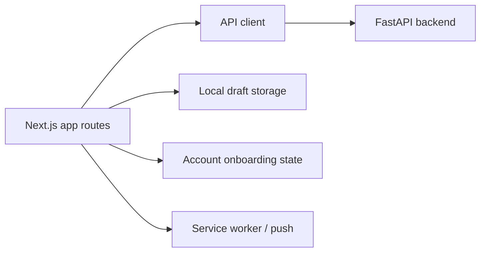

# HAEDORI (해도리) — Frontend

개인화 일기, AI 피드백 편지, 캘린더 및 감정 기록을 제공하는 웹 서비스의 사용자 인터페이스입니다.

## Technology

Next.js App Router, React, TypeScript, Tailwind CSS. See [package.json](package.json) for declared versions.

## Features and engineering

- 자유형·질문형 일기 작성, 캘린더 및 일기 상세 조회.
- 편지함, 감정 리포트, 운세·보상 관련 화면.
- 소셜 로그인 콜백, 사용자 프로필과 알림 설정.
- 브라우저 내 일기 초안 저장 및 복구: 사용자 ID, 날짜, 일기 종류별 키; 새 글/수정 초안 구분; 30일 만료 및 저장 실패 처리.
- 계정별 온보딩 상태: 3단계 소개, 신규 가입 여부 우선 판단, 세션·메모리 기반 중복 노출 방지.
- 서비스 워커와 웹 푸시 연동.



## Code guide

| Area | Source |
|---|---|
| Application pages | [app/](app/) |
| API integration | [lib/api.ts](lib/api.ts) |
| Diary draft recovery | [lib/diary-draft.ts](lib/diary-draft.ts) |
| Account onboarding | [lib/onboarding.ts](lib/onboarding.ts) |
| Web push | [lib/web-push.ts](lib/web-push.ts), [public/sw.js](public/sw.js) |

Drafts are stored locally, not automatically submitted to the backend. Local storage is not a secure encrypted vault; use synthetic content for demos and avoid exposing real diary entries. Onboarding state is scoped to an account on the device; it is not cross-device synchronization.

## Local development

```bash
npm install
npm run dev
# Production build: npm run build
```

Configure the API connection according to the current client configuration and use an isolated backend. Clean-install/build, external service availability and production deployment were not verified for this documentation update.

Backend: [diary-backend](https://github.com/sajuon/diary-backend).
